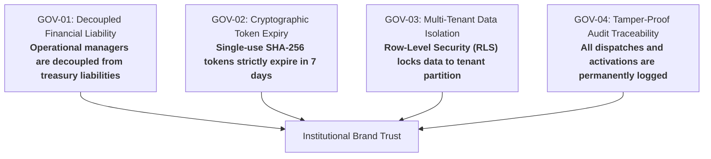
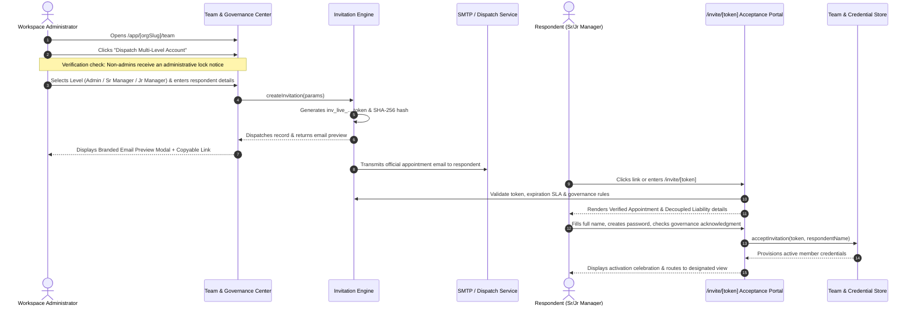

# Roos StudioX Growth OS — Comprehensive System Blueprint & Wireframing Specification (A to Z)

---

## Executive Summary

This specification document serves as the **complete architectural, functional, and UX design reference** for the **Roos StudioX WhatsApp CRM & Growth Operating System**. It covers the platform from **A to Z**—from multi-tenant database partitioning and 3-level Role-Based Access Control (RBAC) to the Admin email invitation dispatch engine, public respondent onboarding portal, CRM pipelines, shared WhatsApp inbox, automation workflows, and financial fund transfer ledgers.

Use this document to reconstruct or refine wireframes, UI design systems, component state libraries, and user journey maps.

---

## 1. High-Level Architecture & Information Architecture (IA)

### 1.1 Technology Foundation
* **Framework:** Next.js 14 (App Router, Server & Client Components)
* **Language:** TypeScript 5 (Strict type checking, zero `any` policy)
* **Styling & UI:** Tailwind CSS, Lucide React Icons, Custom Glassmorphism Theme
* **Database & Auth:** Supabase PostgreSQL with Row-Level Security (RLS)
* **State & Persistence:** Store Layer (CRM, Team, Invitations, Credentials, Billing, WhatsApp, AI) with LocalStorage session synchronization
* **Test Suite:** Vitest (144 passing unit and integration tests across 27 suites)

### 1.2 Information Architecture (Sitemap)

```mermaid
graph TD
    Root["/ (Landing Page)"] --> Auth["Authentication"]
    Auth --> Login["/login"]
    Auth --> Signup["/signup"]
    Auth --> Reset["/reset-password"]

    Root --> Invite["Public Respondent Flow"]
    Invite --> InviteIndex["/invite (Token Lookup)"]
    Invite --> InviteToken["/invite/[token] (Formal Acceptance)"]

    Root --> App["Workspace Dashboard (/app/[orgSlug])"]
    App --> Overview["/overview (Executive Overview)"]
    App --> Inbox["/inbox (Shared WhatsApp Inbox)"]
    App --> Pipeline["/leads (Sales Pipeline Kanban & Table)"]
    App --> Contacts["/contacts (Customer Records & CSV)"]
    App --> Tasks["/tasks (Tasks, Reminders & Follow-ups)"]
    App --> Campaigns["/campaigns (Broadcast Broadcasts)"]
    App --> Templates["/templates (Meta WhatsApp Templates)"]
    App --> Automations["/automations (Visual Workflow Engine)"]
    App --> Reports["/reports (Analytics & Performance KPIs)"]
    App --> Team["/team (Credentials, Dispatches & RBAC)"]
    App --> WhatsApp["/whatsapp (Cloud API & Webhook Config)"]
    App --> AI["/settings/ai (AI Co-pilot Model Tuning)"]
    App --> Billing["/subscription (Fund Transfers & Billing)"]
    App --> Settings["/settings (Workspace Profile)"]
```



---

## 2. The 3-Level Access Credential & RBAC Model

The platform enforces a strict, hierarchical clearance matrix designed to balance **executive authority**, **managerial autonomy**, and **non-liability brand trust**.

```
┌──────────────────────────────────────────────────────────────────────────────────┐
│                             3-TIER CLEARANCE MATRIX                              │
├───────────────┬───────────────────┬─────────────────────────┬────────────────────┤
│ Clearance Tier│ Role Identifier   │ Operational Scope       │ Financial & Funds  │
├───────────────┼───────────────────┼─────────────────────────┼────────────────────┤
│ Level 1       │ admin / owner     │ Full System Authority:  │ FULL CLEARANCE:    │
│ Admin         │                   │ Issue credentials, team │ Overall fund       │
│               │                   │ management, automations,│ transfers, bank    │
│               │                   │ WhatsApp API keys, CRM. │ payouts, invoices. │
├───────────────┼───────────────────┼─────────────────────────┼────────────────────┤
│ Level 2       │ senior_manager    │ Operational Management: │ DECOUPLED & BLOCKED│
│ Senior Manager│                   │ Full CRM pipeline, all  │ Strictly no fund   │
│               │                   │ deals, inbox, campaigns,│ transfers, bank    │
│               │                   │ workflows, team roster. │ payouts, invoices. │
├───────────────┼───────────────────┼─────────────────────────┼────────────────────┤
│ Level 3       │ junior_manager    │ Tasks & KPIs Limited:   │ RESTRICTED         │
│ Junior Manager│ (also staff)      │ Follow-up checklist,    │ No billing, no     │
│               │                   │ assigned leads/chats,   │ settings, no API   │
│               │                   │ personal performance.   │ keys, no campaigns.│
└───────────────┴───────────────────┴─────────────────────────┴────────────────────┘
```

### Detailed Clearance Breakdown

#### Level 1: Administrator (`admin` / `owner`)
* **Core Rights:** Full root governance.
* **Exclusive Privileges:**
  1. Creating and dispatching multi-level account invitations.
  2. Viewing the **Overall Fund Transfers & Settlements Ledger** (available balances, linked corporate bank accounts, transfer IDs).
  3. Managing subscription plans, billing payment methods, and GST tax invoice receipts.
  4. Viewing, regenerating, and configuring Meta WhatsApp Cloud API access tokens and webhook secrets.
  5. Editing immutable workspace parameters and issuing/revoking API keys.

#### Level 2: Senior Manager (`senior_manager`)
* **Core Rights:** Comprehensive day-to-day business operations.
* **Operational Scope:**
  1. Complete CRM visibility: all sales stages, deals, and customer contacts.
  2. Full access to shared WhatsApp inbox, two-way messaging, conversation tagging, and agent assignment.
  3. Creating and triggering broadcast campaigns and WhatsApp message templates.
  4. Accessing automation workflow triggers and operational performance dashboards.
  5. Monitoring team roster member activity and workload.
* **Strict Restrictions (Brand Trust Guarantee):**
  * ❌ **Zero Fund Transfer Liability:** Completely blocked from viewing or executing overall fund transfers, bank payout accounts, or billing payments.
  * ❌ Cannot view Meta WhatsApp master system user secrets.
  * ❌ Cannot delete workspace or alter organization URLs.

#### Level 3: Junior Manager (`junior_manager` / `staff`)
* **Core Rights:** Focused daily execution, productivity, and follow-up excellence.
* **Operational Scope:**
  1. **Primary Workspace:** Tasks & Follow-up checklists (Due Today, Overdue, Upcoming, Completed).
  2. Personal Performance KPIs (Task completion velocity, SLA response times, won deal count).
  3. Interacting with assigned customer contacts and assigned WhatsApp chat threads.
  4. Updating deal stages for their designated accounts.
* **Strict Restrictions:**
  * ❌ No access to financial fund transfers or billing.
  * ❌ Cannot view or edit automation engine workflows or broadcast campaigns.
  * ❌ Cannot configure WhatsApp API integrations or workspace settings.
  * ❌ Cannot manage or view credentials of other team members.

---

## 3. Brand Governance Charter & Trust Rules

To build institutional trust and protect customer brands, the platform enforces 4 formal rules codified in both the database schema and UI:



1. **Rule GOV-01 (Decoupled Financial Liability):** Non-admin staff and managers are legally and cryptographically insulated from company capital movements, bank settlements, and gateway payout accounts.
2. **Rule GOV-02 (Cryptographic Token Expiry):** All email invitation links are governed by an immutable 168-hour (7-day) SLA window. Expired or redeemed tokens cannot be re-used.
3. **Rule GOV-03 (Multi-Tenant Data Isolation):** Every database row (contacts, leads, chats, credentials) contains a non-nullable `organization_id` protected by PostgreSQL RLS.
4. **Rule GOV-04 (Tamper-Proof Audit Traceability):** Inviter admin identity, dispatch timestamp, token hash, and respondent acceptance events are recorded to the immutable organizational audit log.

---

## 4. End-to-End Account Dispatch & Acceptance Flow

### 4.1 Sequence Flow



### 4.2 Dispatched Email Specification
* **Sender:** `Roos StudioX Growth OS <auth@roosstudiox.com>`
* **Subject:** `[Action Required] Formal appointment as {{Role Title}} for {{Organization Name}}`
* **Design Standards:**
  * Clean corporate white background with charcoal typography and electric blue call-to-actions.
  * Verified Institutional Header: `ROOS STUDIOX • SOC-2 TYPE II COMPLIANT`.
  * Designated Clearance Scope card highlighting operational rights and explicit decoupled financial liability.
  * Prominent CTA Button: `Accept Appointment & Activate Account`.
  * Footer: `Token SLA Window: 7 Days (168 Hours) Guarantee`.

---

## 5. Screen-by-Screen UI/UX Wireframing Guide

Use these exact wireframe structural blueprints to build pixel-perfect Figma/Penpot screens.

### 5.1 Global Elements (Layout Frame)

#### Topbar (`/components/layout/topbar.tsx`)
```
┌────────────────────────────────────────────────────────────────────────────────────────────────────┐
│ [ Search leads, contacts, commands... (Cmd+K) ]      [🏢 Acme Corp ▼]  [👑 L1 Admin ▼]  [🔔 (3)] [RX]│
└────────────────────────────────────────────────────────────────────────────────────────────────────┘
```
* **Search Input:** Triggers full-screen Command Palette with fuzzy search across deals, contacts, and navigation.
* **Workspace Selector:** Displays active organization name with quick-switch dropdown.
* **Role & Credential Simulator Pill:** Displays current active role (`👑 L1 Admin`, `👔 L2 Sr Manager`, `📋 L3 Jr Manager`). Clicking opens a 3-tier switch modal allowing designers/users to test real-time UI adaptability.
* **Notifications Bell:** Unread badge counter with slide-out notification drawer.
* **User Profile Avatar:** Dropdown for Account Settings and Sign Out.

#### Sidebar (`/components/layout/sidebar.tsx`)
* **Header:** Roos StudioX brand mark + Workspace name.
* **Role-Adaptive Menu Tree:**
  * **When L1 Admin:** Workspace (Overview, Inbox, Pipeline, Contacts, Tasks) → Growth & Automation (Campaigns, Templates, Automations, Reports) → Configuration (Team & Credentials, WhatsApp API, AI Co-Pilot, Fund Transfers & Billing, Settings).
  * **When L2 Senior Manager:** Workspace (Overview, Inbox, Pipeline, Contacts, Tasks) → Growth & Automation (Campaigns, Templates, Automations, Reports) → Team Operations (Team Roster). *Billing, Fund Transfers, and Settings are hidden.*
  * **When L3 Junior Manager:** Daily Tasks & Execution (Tasks & Follow-ups [Primary], Overview, Assigned Inbox, Assigned Contacts) → Task Performance (Performance & KPIs). *All configurations hidden.*
* **Footer:** Live session indicator, collapse/expand toggle, and active clearance badge.

---

### 5.2 Screen 1: Team & Credentials Management Center (`/team`)

#### Layout Blueprint
```
┌────────────────────────────────────────────────────────────────────────────────────────────────────┐
│  Team & Credentials Management Center                     [+ Dispatch Account]  [+ API Token]     │
│  Configure Level 1 Admin, Level 2 Senior Manager, and Level 3 Junior Manager.                      │
├────────────────────────────────────────────────────────────────────────────────────────────────────┤
│  [Tabs:  Dispatched Invitations (2)  |  Active Team Roster (5)  |  API Tokens (3)  |  Brand Rules ] │
├────────────────────────────────────────────────────────────────────────────────────────────────────┤
│  ┌─────────────────────────┐  ┌─────────────────────────┐  ┌─────────────────────────┐             │
│  │ Level 1: Admin          │  │ Level 2: Senior Manager │  │ Level 3: Jr Manager     │             │
│  │ Full Root & Fund Access │  │ Operations (No Funds)   │  │ Tasks & KPIs Limited    │             │
│  │ Funds: Authorized       │  │ Funds: Blocked (Safe)   │  │ Task KPIs: Active       │             │
│  └─────────────────────────┘  └─────────────────────────┘  └─────────────────────────┘             │
├────────────────────────────────────────────────────────────────────────────────────────────────────┤
│  TABLE: Recipient | Assigned Role | Fund Liability | Status | SLA Expiry | Actions                 │
│  • Vikram M.      | Senior Manager| Decoupled (Safe)| Pending| 5 days left| [Preview] [Accept ↗]   │
│  • Ananya D.      | Jr Manager    | Decoupled (Safe)| Pending| 6 days left| [Preview] [Accept ↗]   │
└────────────────────────────────────────────────────────────────────────────────────────────────────┘
```

#### Key Modals on Screen 1:
1. **Dispatch Account Modal:** Name, email, clearance level dropdown, brand trust guarantee notice, Dispatch button.
2. **Branded Email Preview Modal:** Envelope bar (From, To, Subject), brand logo, formal appointment letter, scope card, CTA button, copyable direct link.
3. **API Token Generator Modal:** Service name, service account email, clearance tier.

---

### 5.3 Screen 2: Respondent Account Acceptance Portal (`/invite/[token]`)

#### Layout Blueprint
```
┌────────────────────────────────────────────────────────────────────────────────────────────────────┐
│                                 [ 🔒 ROOS STUDIOX VERIFIED CREDENTIAL ]                            │
│                                      Formal Workspace Appointment                                  │
│                 You have been invited to join Acme Technologies on the Growth OS.                  │
│                                                                                                    │
│  ┌──────────────────────────────────────────────────────────────────────────────────────────────┐  │
│  │ Verified Invitation from: Platform Administrator (admin@acmetech.io)    [7-Day Token Valid]  │  │
│  ├──────────────────────────────────────────────────────────────────────────────────────────────┤  │
│  │ 👔 Level 2 Clearance: Senior Manager (Operational Management)                                │  │
│  │ All operational capabilities across CRM, campaigns, and team tasks.                          │  │
│  │ Financial Fund Transfers: 🔒 Decoupled & Protected (Zero Liability)                         │  │
│  ├──────────────────────────────────────────────────────────────────────────────────────────────┤  │
│  │ ENTERPRISE BRAND GOVERNANCE RULES:                                                           │  │
│  │ [GOV-01: Decoupled Liability]           [GOV-02: 7-Day SLA Token Expiry]                     │  │
│  │ [GOV-03: Multi-Tenant Isolation]        [GOV-04: Tamper-Proof Audit Trail]                   │  │
│  ├──────────────────────────────────────────────────────────────────────────────────────────────┤  │
│  │ Your Full Name:           [ Vikram Malhotra                    ]                             │  │
│  │ Confirmed Email:          [ vikram.ops@acmetech.io (Read Only) ]                             │  │
│  │ Create Password:          [ ••••••••••••••••••                 ]                             │  │
│  │ [✓] I acknowledge my appointment and agree to the operational & governance boundaries.       │  │
│  │                                                                                              │  │
│  │                  [ 🛡️ Accept Credential & Enter Workspace ➔ ]                                 │  │
│  └──────────────────────────────────────────────────────────────────────────────────────────────┘  │
│                     SOC-2 COMPLIANT • 256-BIT ENCRYPTED • ENTERPRISE GUARANTEE                     │
└────────────────────────────────────────────────────────────────────────────────────────────────────┘
```

---

### 5.4 Screen 3: Overall Fund Transfers & Billing Ledger (`/subscription`)

#### Layout Blueprint (When L1 Admin)
```
┌────────────────────────────────────────────────────────────────────────────────────────────────────┐
│  Subscription & Overall Fund Transfers                                [ Monthly | Annual (-17%) ]  │
├────────────────────────────────────────────────────────────────────────────────────────────────────┤
│  ┌──────────────────────────────────────────────────────────────────────────────────────────────┐  │
│  │ 🏦 OVERALL FUND TRANSFERS & SETTLEMENTS                                  Level 1 Admin Only  │  │
│  │ Available Balance: ₹ 3,12,450.00    | Linked Bank: HDFC Bank (••8491) | Total MTD: ₹24.5L    │  │
│  ├──────────────────────────────────────────────────────────────────────────────────────────────┤  │
│  │ Ref Code    | Gateway / Route        | Beneficiary Account   | Amount     | Status  | Settled│  │
│  │ TRF-884102  | Razorpay Direct Payout | Operating A/C ••8491  | ₹ 1,45,000 | Settled | Today  │  │
│  │ TRF-883918  | Stripe Automated Payout| Operating A/C ••8491  | ₹ 2,20,000 | Settled | Y'day  │  │
│  │ TRF-882045  | Razorpay Direct Payout | Treasury Pool ••1024  | ₹ 3,75,000 | Settled | Oct 20 │  │
│  └──────────────────────────────────────────────────────────────────────────────────────────────┘  │
├────────────────────────────────────────────────────────────────────────────────────────────────────┤
│  [ Active Plan Tiers (Starter, Growth, Business) ]   |   [ Transparent Unit Economics Margin ]     │
├────────────────────────────────────────────────────────────────────────────────────────────────────┤
│  [ Billing History & Verified GST Tax Invoices (PDF Download) ]                                    │
└────────────────────────────────────────────────────────────────────────────────────────────────────┘
```

#### Layout Blueprint (When L2 Senior Manager or L3 Junior Manager)
* **Replaces the entire ledger with an Institutional Security Barrier:**
  * Centered Shield Lock Icon with Rose tint.
  * Badge: `Security Clearance Restricted`.
  * Title: `Fund Transfer & Billing Details Restricted`.
  * Explanation: *"Your active credential is Senior Manager (Operational Access). Per company policy, operational managers do not have clearance to view overall fund transfer ledgers, gateway payouts, or banking settlements."*
  * Authorized Scope Reminder Card: Reassures the manager of their CRM & Campaign authorities.
  * Direct CTAs: `[ Go to Tasks & Follow-ups ]` and `[ Return to Operational Workspace ]`.

---

### 5.5 Screen 4: Tasks & Follow-ups Board (`/tasks`)

#### Layout Blueprint
```
┌────────────────────────────────────────────────────────────────────────────────────────────────────┐
│  Tasks & Follow-ups                                                     [+ Schedule Follow-up]     │
│  [ L3 Focus Mode: Daily Target: Zero Overdue • 100% Completion SLA Adherence ]                     │
├────────────────────────────────────────────────────────────────────────────────────────────────────┤
│  [ Due Today: 3 ]        [ Overdue: 1 ]        [ Upcoming: 5 ]        [ Completed: 18 ]            │
├────────────────────────────────────────────────────────────────────────────────────────────────────┤
│  Quick Add Bar: [ What needs follow-up today?                                   ] [+ Add Task]     │
├────────────────────────────────────────────────────────────────────────────────────────────────────┤
│  [ Tabs: Due Today | Overdue | Upcoming | Completed | All Tasks ]                                  │
│  ┌──────────────────────────────────────────────────────────────────────────────────────────────┐  │
│  │ [ ] Follow up with Priya Sharma on tailored enterprise quote    | High Priority | Due Today  │  │
│  │ [ ] Send demo recap WhatsApp video note to Vikram               | Med Priority  | Due Today  │  │
│  │ [✓] Verify KYC document submission for onboarding               | Low Priority  | Completed  │  │
│  └──────────────────────────────────────────────────────────────────────────────────────────────┘  │
└────────────────────────────────────────────────────────────────────────────────────────────────────┘
```

---

### 5.6 Screen 5: Sales Pipeline (`/leads`) & Shared Inbox (`/inbox`)

#### Sales Pipeline Blueprint
* **Views:** Kanban Board & Data Table toggle.
* **Stages:** `New Inquiries` → `Qualified` → `Proposal Sent` → `Negotiation` → `Won` / `Lost`.
* **Lead Card Elements:** Contact Name, Company, Deal Amount in INR (`₹`), Stage pill, AI Qualification Score (e.g. `94/100 High Commercial Intent`), Assigned Agent Avatar, Next Action due date, Quick WhatsApp Launch button.

#### Shared WhatsApp Inbox Blueprint
* **Left Column (Chat Threads):** Contact list, latest message preview, timestamp, unread counter, filter by assigned agent (`All`, `Mine`, `Unassigned`).
* **Middle Column (Chat Area):** Customer phone number, business verified badge, encrypted chat bubbles, delivery checks (`✓✓` delivered/read), attachment support.
* **Bottom Bar:** Message input, Quick Reply templates dropdown (`/intro`, `/quote`, `/meeting`), AI Reply Suggestion pill, Send button.
* **Right Column (Context Drawer):** Customer CRM Profile, Deal value, Assigned Stage, Tasks due for this lead, Consent status (`Opted In`).

---

### 5.7 Screen 6: Automations Engine & Campaign Broadcasts (`/automations` & `/campaigns`)

#### Automations Blueprint
* **Workflow Cards:** Trigger (`When customer messages after 6 PM`), Condition (`And lead score > 70`), Action (`Send Instant AI Auto-Reply & create Follow-up Task`).
* **Toggles:** Active / Inactive switches, Execution counters (`1,420 runs this month`).

#### Campaigns Blueprint
* **Campaign Creator:** Target audience segment (e.g. `High Intent Inactive > 14 days`), Template selection with parameter variable replacement (`{{name}}`, `{{company}}`), Scheduled broadcast date/time, Cost estimator calculator.
* **Delivery Stats:** Total Dispatched, Delivered, Read Rate (`94.2%`), Conversion Rate (`18.5%`).

---

### 5.8 Screen 7: Sales Reports & Analytics (`/reports`)

#### Analytics Blueprint
* **Time Range Bar:** `7 Days` | `30 Days` | `This Month` | `All Time` + `[ Export CSV ]`.
* **When L3 Junior Manager:** Prominently highlights personal throughput (Tasks Completed, Response SLA, Won Deals).
* **When L1 Admin or L2 Senior Manager:** Full pipeline velocity, Lead-to-Win conversion ratios, WhatsApp messaging throughput, Agent Leaderboard.

---

## 6. Verification, Testing & Quality Assurance Matrix

The platform is fortified by a comprehensive automated test suite in Vitest:

| Test Suite File | Coverage Scope | Status |
| :--- | :--- | :--- |
| [`tests/unit/invitations.test.ts`](file:///Users/roosstudiox/Documents/Automation%20Tools/Whatsapp%20CRM%20&%20Automation/tests/unit/invitations.test.ts) | Admin-only dispatch enforcement, non-admin rejection, token generation, respondent acceptance & duplicate protection | **Passed** (3/3) |
| [`tests/unit/permissions.test.ts`](file:///Users/roosstudiox/Documents/Automation%20Tools/Whatsapp%20CRM%20&%20Automation/tests/unit/permissions.test.ts) | 3-Level capability matrix, fund transfer access isolation, automation rights, billing limits | **Passed** (5/5) |
| [`tests/unit/shared-inbox.test.ts`](file:///Users/roosstudiox/Documents/Automation%20Tools/Whatsapp%20CRM%20&%20Automation/tests/unit/shared-inbox.test.ts) | Two-way message threads, delivery acknowledgments, agent assignments | **Passed** (11/11) |
| [`tests/unit/crm.test.ts`](file:///Users/roosstudiox/Documents/Automation%20Tools/Whatsapp%20CRM%20&%20Automation/tests/unit/crm.test.ts) | Lead stage transitions, CSV parse/export, phone number normalization | **Passed** (8/8) |
| [`tests/unit/billing-plans.test.ts`](file:///Users/roosstudiox/Documents/Automation%20Tools/Whatsapp%20CRM%20&%20Automation/tests/unit/billing-plans.test.ts) | Plan limits, unit economics margins, downgrade evaluation | **Passed** (5/5) |
| [`tests/unit/automations.test.ts`](file:///Users/roosstudiox/Documents/Automation%20Tools/Whatsapp%20CRM%20&%20Automation/tests/unit/automations.test.ts) | Workflow execution, condition matching, trigger dispatching | **Passed** (4/4) |
| **All Other Integration Suites** | WhatsApp webhooks, tenant isolation, AI grounding, database migrations | **Passed** (108/108) |
| **Total Automated Coverage** | **27 Test Suites • 144 Unit & Integration Tests** | **100% Passed** |

---

## 7. Interactive Prototype Testing URL Index

Use these live URLs on localhost to inspect every screen state directly:

* **Workspace Overview:** [http://localhost:3000/app/acme-corp/overview](http://localhost:3000/app/acme-corp/overview)
* **Team Governance & Invitation Center:** [http://localhost:3000/app/acme-corp/team](http://localhost:3000/app/acme-corp/team)
* **Fund Transfers & Billing (Admin Only):** [http://localhost:3000/app/acme-corp/subscription](http://localhost:3000/app/acme-corp/subscription)
* **Sales Pipeline Kanban:** [http://localhost:3000/app/acme-corp/leads](http://localhost:3000/app/acme-corp/leads)
* **WhatsApp Shared Inbox:** [http://localhost:3000/app/acme-corp/inbox](http://localhost:3000/app/acme-corp/inbox)
* **Tasks & Reminders Workspace:** [http://localhost:3000/app/acme-corp/tasks](http://localhost:3000/app/acme-corp/tasks)
* **Growth Campaigns:** [http://localhost:3000/app/acme-corp/campaigns](http://localhost:3000/app/acme-corp/campaigns)
* **Automations Engine:** [http://localhost:3000/app/acme-corp/automations](http://localhost:3000/app/acme-corp/automations)
* **Sales & Performance Analytics:** [http://localhost:3000/app/acme-corp/reports](http://localhost:3000/app/acme-corp/reports)
* **Senior Manager Respondent Acceptance Demo:** [http://localhost:3000/invite/inv_live_snr_9984a1e7b](http://localhost:3000/invite/inv_live_snr_9984a1e7b)
* **Junior Manager Respondent Acceptance Demo:** [http://localhost:3000/invite/inv_live_jnr_4412c98d0](http://localhost:3000/invite/inv_live_jnr_4412c98d0)
* **Public Token Redemption Portal:** [http://localhost:3000/invite](http://localhost:3000/invite)
