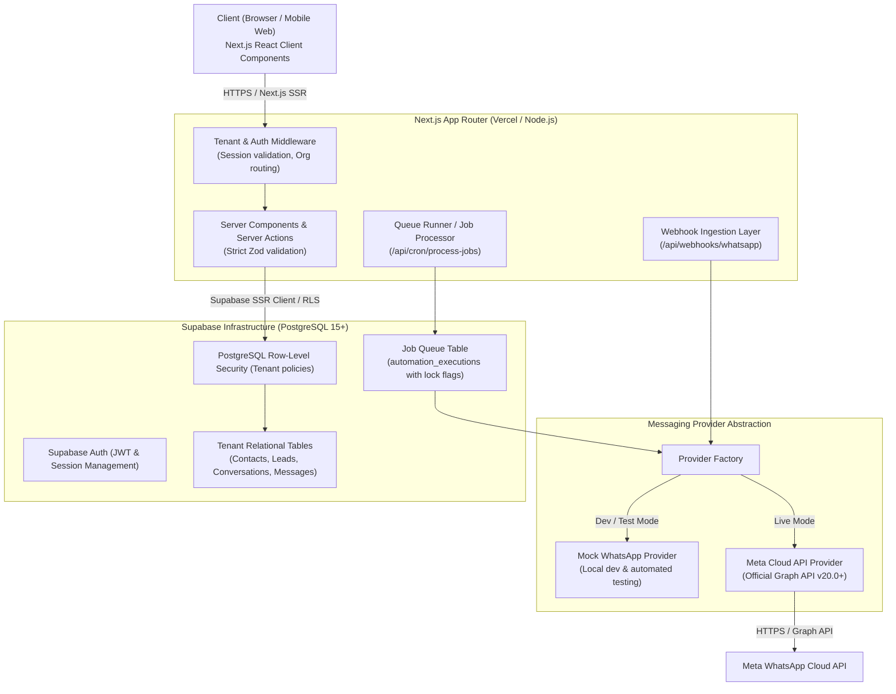

# System Architecture Specification

## 1. Executive Summary

This document specifies the architectural foundation for the **WhatsApp Automation & CRM SaaS**, an enterprise-grade, multi-tenant Business Operating System module engineered for small businesses.

The system is designed around four non-negotiable principles:
1. **Strict Multi-Tenant Isolation**: Hard isolation of tenant data at both the PostgreSQL Row-Level Security (RLS) layer and application layer.
2. **Provider Abstraction**: Decoupled messaging infrastructure that operates seamlessly in mock mode (development/testing) and live mode (official Meta WhatsApp Business Platform Cloud API).
3. **Database-Backed Persistent Queueing**: No reliance on fragile browser tabs or expensive serverless brokers for automations and scheduled follow-ups; all jobs are stored in transactional PostgreSQL queues with bounded retries and idempotency keys.
4. **Cost-Constrained Production Viability**: Budgeted within ₹5,000–₹15,000/month, avoiding proprietary lock-in, unnecessary paid SaaS addons, or unbounded compute resources.

---

## 2. Technology Stack & Component Topology



### Component Breakdown
- **Frontend & App Framework**: Next.js (App Router), React 19, TypeScript (Strict Mode).
- **Styling & UI Kit**: Tailwind CSS and shadcn/ui (Radix UI primitives). High contrast, accessible, responsive design system.
- **Database & Auth**: Supabase PostgreSQL 15+, Supabase Auth with PKCE auth flow, PostgreSQL Row Level Security (RLS) on 100% of tenant tables.
- **Queue & Scheduling**: Transactional database queue (`automation_executions`) processed via deterministic batching with pessimistic locking (`FOR UPDATE SKIP LOCKED`) triggered by periodic server cron.
- **External Integration**: Official Meta WhatsApp Business Platform Cloud API with webhook signature verification (`X-Hub-Signature-256`).

---

## 3. Directory & Folder Structure

```
whatsapp-crm-saas/
├── .github/
│   └── workflows/              # GitHub Actions CI (lint, typecheck, tests)
├── docs/                       # Architectural documentation and runbooks
│   ├── ARCHITECTURE.md         # System architecture & component topology
│   ├── DATABASE_SCHEMA.md      # Full table schemas, relationships & ERD
│   ├── MULTI_TENANCY.md        # RLS policies, role hierarchy & security rules
│   ├── WHATSAPP_INTEGRATION.md # Meta API & Mock Provider specifications
│   └── ROADMAP.md              # Milestone tracker & delivery checklist
├── supabase/
│   ├── migrations/             # Timestamped SQL migrations with RLS
│   │   ├── 20261012000001_initial_schema.sql
│   │   └── 20261012000002_rls_policies.sql
│   └── seed.sql                # Dev test data (Org A, Org B, sample leads)
├── src/
│   ├── app/                    # Next.js App Router
│   │   ├── (auth)/             # Authentication views
│   │   │   ├── login/page.tsx
│   │   │   ├── signup/page.tsx
│   │   │   ├── reset-password/page.tsx
│   │   │   └── auth/callback/route.ts
│   │   ├── (dashboard)/        # Multi-tenant workspace layout
│   │   │   ├── [orgSlug]/
│   │   │   │   ├── layout.tsx  # Dashboard layout (Sidebar, Header, Tenant Context)
│   │   │   │   ├── overview/page.tsx
│   │   │   │   ├── inbox/page.tsx
│   │   │   │   ├── leads/
│   │   │   │   │   ├── page.tsx
│   │   │   │   │   └── [leadId]/page.tsx
│   │   │   │   ├── contacts/
│   │   │   │   │   ├── page.tsx
│   │   │   │   │   └── [contactId]/page.tsx
│   │   │   │   ├── automations/page.tsx
│   │   │   │   ├── tasks/page.tsx
│   │   │   │   ├── reports/page.tsx
│   │   │   │   ├── team/page.tsx
│   │   │   │   ├── whatsapp/page.tsx
│   │   │   │   ├── subscription/page.tsx
│   │   │   │   └── settings/page.tsx
│   │   │   └── select-org/page.tsx
│   │   ├── api/
│   │   │   ├── webhooks/
│   │   │   │   ├── whatsapp/route.ts     # Meta Cloud API Webhook
│   │   │   │   └── mock-whatsapp/route.ts# Dev Mock message generator
│   │   │   └── cron/
│   │   │       └── process-jobs/route.ts # Job queue batch executor
│   │   ├── layout.tsx
│   │   ├── page.tsx            # Marketing / Landing / App entrypoint
│   │   └── globals.css
│   ├── components/
│   │   ├── ui/                 # Reusable shadcn/ui components
│   │   ├── layout/             # Sidebar, Navbar, OrgSwitcher, UserMenu
│   │   ├── crm/                # ContactsTable, PipelineBoard, LeadDetailView
│   │   ├── inbox/              # ChatList, MessageThread, MessageComposer
│   │   ├── automations/        # RuleCard, TriggerSelector, ExecutionLog
│   │   └── shared/             # MetricCard, EmptyState, StatusBadge, Pagination
│   ├── lib/
│   │   ├── supabase/
│   │   │   ├── client.ts       # Browser Supabase client
│   │   │   ├── server.ts       # Next.js Server Component / Action client
│   │   │   ├── admin.ts        # Privileged service-role client (server only)
│   │   │   └── middleware.ts   # Session & auth middleware
│   │   ├── whatsapp/
│   │   │   ├── types.ts        # Message and webhook interfaces
│   │   │   ├── provider.ts     # Abstract IWhatsAppProvider interface
│   │   │   ├── mock-provider.ts# In-memory / DB mock provider
│   │   │   ├── meta-provider.ts# Official Meta Cloud API provider
│   │   │   └── factory.ts      # Provider instantiator per organization
│   │   ├── queue/
│   │   │   ├── job-queue.ts    # Enqueue & execution functions
│   │   │   └── handlers/       # Execution handlers (tasks, messaging, etc.)
│   │   ├── subscriptions/
│   │   │   ├── tiers.ts        # Plan limits: Starter, Growth, Business
│   │   │   └── check-limits.ts # Entitlement & quota enforcer
│   │   ├── validations/        # Zod input schemas
│   │   └── utils.ts            # Classnames, date formatters, currency
│   ├── types/
│   │   ├── database.types.ts   # Generated Supabase DB types
│   │   └── domain.ts           # Domain models and application enums
│   └── middleware.ts           # Root Next.js middleware
├── tests/
│   ├── unit/                   # Unit test suite (Jest / Vitest)
│   ├── integration/            # Multi-tenant RLS isolation test suite
│   └── e2e/                    # Critical journey tests (Playwright)
├── .env.example
├── .gitignore
├── package.json
├── tsconfig.json
└── tailwind.config.ts
```

---

## 4. Background Job Processing Model

To eliminate recurring costs for third-party queuing platforms (like BullMQ + Redis or AWS SQS) while maintaining absolute persistence and reliability:

1. **Table as Queue**: The `automation_executions` table doubles as a persistent FIFO/priority queue.
2. **Concurrency Safe Dequeue**:
   ```sql
   UPDATE automation_executions
   SET status = 'processing', started_at = NOW()
   WHERE id IN (
     SELECT id FROM automation_executions
     WHERE status IN ('pending', 'retrying')
       AND scheduled_for <= NOW()
     ORDER BY scheduled_for ASC
     LIMIT 50
     FOR UPDATE SKIP LOCKED
   )
   RETURNING *;
   ```
3. **Trigger**: An automated scheduler (e.g. Supabase `pg_cron` or Vercel Cron at `/api/cron/process-jobs`) fires every minute, protected by a shared secret header (`CRON_SECRET`).
4. **Idempotency & Retries**:
   - Every execution record carries an `idempotency_key` (e.g., `lead-stage-change:{leadId}:{stage}:{timestamp_minute}`).
   - Max retries capped at 3 with exponential backoff (`scheduled_for = NOW() + INTERVAL '2 minutes' * retry_count`).
   - If an unhandled exception occurs, status transitions to `retrying` or `failed` with error logs recorded.
