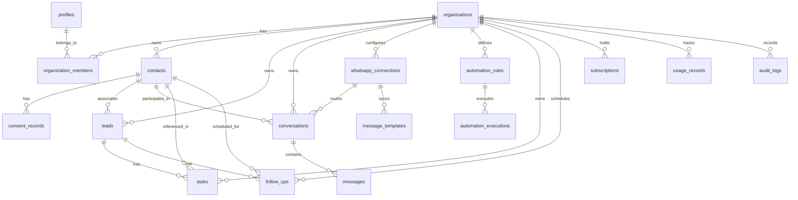

# Database Schema & Data Relationships

## 1. Overview

The database uses PostgreSQL (hosted on Supabase). Multi-tenancy is enforced natively through `organization_id` foreign keys on all tenant-owned tables and PostgreSQL Row-Level Security (RLS).

---

## 2. Entity-Relationship Diagram

---

## 3. Detailed Table Definitions

### 1. `organizations`
Workspace container for a business tenant.
- `id` (UUID, PK, default `gen_random_uuid()`)
- `name` (TEXT, NOT NULL)
- `slug` (TEXT, UNIQUE, NOT NULL) - URL identifier for workspace routing
- `logo_url` (TEXT, NULL)
- `plan_tier` (TEXT, NOT NULL, DEFAULT 'starter') - 'starter' | 'growth' | 'business'
- `is_active` (BOOLEAN, NOT NULL, DEFAULT TRUE)
- `created_at` (TIMESTAMPTZ, NOT NULL, DEFAULT NOW())
- `updated_at` (TIMESTAMPTZ, NOT NULL, DEFAULT NOW())

### 2. `organization_members`
User membership and roles within an organization.
- `id` (UUID, PK, default `gen_random_uuid()`)
- `organization_id` (UUID, NOT NULL, FK `organizations.id` ON DELETE CASCADE)
- `user_id` (UUID, NULL, FK `auth.users.id` ON DELETE SET NULL)
- `role` (TEXT, NOT NULL, DEFAULT 'staff') - 'owner' | 'admin' | 'staff'
- `invited_email` (TEXT, NULL)
- `invitation_token` (TEXT, NULL, UNIQUE)
- `status` (TEXT, NOT NULL, DEFAULT 'active') - 'active' | 'invited' | 'suspended'
- `joined_at` (TIMESTAMPTZ, NULL)
- `created_at` (TIMESTAMPTZ, NOT NULL, DEFAULT NOW())
- `updated_at` (TIMESTAMPTZ, NOT NULL, DEFAULT NOW())
- *Constraint*: `UNIQUE(organization_id, user_id)`

### 3. `profiles`
User metadata extending Supabase `auth.users`.
- `id` (UUID, PK, FK `auth.users.id` ON DELETE CASCADE)
- `email` (TEXT, NOT NULL)
- `full_name` (TEXT, NULL)
- `avatar_url` (TEXT, NULL)
- `created_at` (TIMESTAMPTZ, NOT NULL, DEFAULT NOW())
- `updated_at` (TIMESTAMPTZ, NOT NULL, DEFAULT NOW())

### 4. `contacts`
Customer directory record.
- `id` (UUID, PK, default `gen_random_uuid()`)
- `organization_id` (UUID, NOT NULL, FK `organizations.id` ON DELETE CASCADE)
- `first_name` (TEXT, NOT NULL)
- `last_name` (TEXT, NULL)
- `phone` (TEXT, NOT NULL) - Normalized E.164 format (e.g. `+919876543210`)
- `email` (TEXT, NULL)
- `company` (TEXT, NULL)
- `tags` (TEXT[], DEFAULT '{}')
- `source` (TEXT, NULL)
- `notes` (TEXT, NULL)
- `is_archived` (BOOLEAN, NOT NULL, DEFAULT FALSE)
- `created_at` (TIMESTAMPTZ, NOT NULL, DEFAULT NOW())
- `updated_at` (TIMESTAMPTZ, NOT NULL, DEFAULT NOW())
- *Indexes*: `(organization_id, phone)`, `(organization_id, email)`, `(organization_id, is_archived)`

### 5. `consent_records`
Explicit marketing consent & opt-out tracking (Meta Compliance).
- `id` (UUID, PK, default `gen_random_uuid()`)
- `organization_id` (UUID, NOT NULL, FK `organizations.id` ON DELETE CASCADE)
- `contact_id` (UUID, NOT NULL, FK `contacts.id` ON DELETE CASCADE)
- `channel` (TEXT, NOT NULL, DEFAULT 'whatsapp') - 'whatsapp' | 'email'
- `consent_status` (TEXT, NOT NULL) - 'opted_in' | 'opted_out' | 'pending'
- `consent_source` (TEXT, NULL) - 'website_form', 'incoming_whatsapp', 'manual'
- `opted_in_at` (TIMESTAMPTZ, NULL)
- `opted_out_at` (TIMESTAMPTZ, NULL)
- `notes` (TEXT, NULL)
- `created_at` (TIMESTAMPTZ, NOT NULL, DEFAULT NOW())
- *Indexes*: `(organization_id, contact_id, channel)`

### 6. `leads`
Sales deals and opportunities associated with contacts.
- `id` (UUID, PK, default `gen_random_uuid()`)
- `organization_id` (UUID, NOT NULL, FK `organizations.id` ON DELETE CASCADE)
- `contact_id` (UUID, NOT NULL, FK `contacts.id` ON DELETE RESTRICT)
- `title` (TEXT, NOT NULL)
- `stage` (TEXT, NOT NULL, DEFAULT 'new') - 'new' | 'contacted' | 'qualified' | 'proposal' | 'won' | 'lost'
- `source` (TEXT, NULL)
- `assigned_to_user_id` (UUID, NULL, FK `organization_members.user_id` ON DELETE SET NULL)
- `estimated_value` (NUMERIC(12,2), DEFAULT 0)
- `currency` (TEXT, NOT NULL, DEFAULT 'INR')
- `next_follow_up_at` (TIMESTAMPTZ, NULL)
- `lost_reason` (TEXT, NULL)
- `notes` (TEXT, NULL)
- `created_at` (TIMESTAMPTZ, NOT NULL, DEFAULT NOW())
- `updated_at` (TIMESTAMPTZ, NOT NULL, DEFAULT NOW())
- *Indexes*: `(organization_id, stage)`, `(organization_id, assigned_to_user_id)`, `(organization_id, next_follow_up_at)`

### 7. `whatsapp_connections`
Tenant configuration for WhatsApp messaging.
- `id` (UUID, PK, default `gen_random_uuid()`)
- `organization_id` (UUID, NOT NULL, FK `organizations.id` ON DELETE CASCADE, UNIQUE)
- `mode` (TEXT, NOT NULL, DEFAULT 'mock') - 'mock' | 'live'
- `phone_number_id` (TEXT, NULL)
- `waba_id` (TEXT, NULL)
- `access_token_encrypted` (TEXT, NULL)
- `webhook_verify_token` (TEXT, NOT NULL, DEFAULT gen_random_uuid()::TEXT)
- `status` (TEXT, NOT NULL, DEFAULT 'disconnected') - 'disconnected' | 'connected' | 'error'
- `error_message` (TEXT, NULL)
- `last_synced_at` (TIMESTAMPTZ, NULL)
- `created_at` (TIMESTAMPTZ, NOT NULL, DEFAULT NOW())
- `updated_at` (TIMESTAMPTZ, NOT NULL, DEFAULT NOW())

### 8. `conversations`
Shared inbox conversation threads.
- `id` (UUID, PK, default `gen_random_uuid()`)
- `organization_id` (UUID, NOT NULL, FK `organizations.id` ON DELETE CASCADE)
- `contact_id` (UUID, NOT NULL, FK `contacts.id` ON DELETE CASCADE)
- `whatsapp_connection_id` (UUID, NOT NULL, FK `whatsapp_connections.id` ON DELETE RESTRICT)
- `last_message_at` (TIMESTAMPTZ, NOT NULL, DEFAULT NOW())
- `last_customer_message_at` (TIMESTAMPTZ, NULL) - **Critical for 24-hour Meta customer window calculation**
- `status` (TEXT, NOT NULL, DEFAULT 'open') - 'open' | 'closed' | 'snoozed'
- `assigned_to_user_id` (UUID, NULL, FK `organization_members.user_id` ON DELETE SET NULL)
- `created_at` (TIMESTAMPTZ, NOT NULL, DEFAULT NOW())
- `updated_at` (TIMESTAMPTZ, NOT NULL, DEFAULT NOW())
- *Indexes*: `(organization_id, contact_id)`, `(organization_id, last_message_at DESC)`

### 9. `messages`
Individual WhatsApp chat messages.
- `id` (UUID, PK, default `gen_random_uuid()`)
- `organization_id` (UUID, NOT NULL, FK `organizations.id` ON DELETE CASCADE)
- `conversation_id` (UUID, NOT NULL, FK `conversations.id` ON DELETE CASCADE)
- `sender_type` (TEXT, NOT NULL) - 'customer' | 'staff' | 'system' | 'automation'
- `sender_id` (UUID, NULL, FK `auth.users.id` ON DELETE SET NULL)
- `external_message_id` (TEXT, NULL) - Meta `wamid` for deduplication and receipt tracking
- `message_type` (TEXT, NOT NULL, DEFAULT 'text') - 'text' | 'template' | 'image' | 'document'
- `body` (TEXT, NOT NULL)
- `media_url` (TEXT, NULL)
- `template_name` (TEXT, NULL)
- `status` (TEXT, NOT NULL, DEFAULT 'queued') - 'queued' | 'sent' | 'delivered' | 'read' | 'failed'
- `error_message` (TEXT, NULL)
- `cost_units` (INTEGER, NOT NULL, DEFAULT 0)
- `created_at` (TIMESTAMPTZ, NOT NULL, DEFAULT NOW())
- *Indexes*: `(organization_id, conversation_id, created_at ASC)`, `(organization_id, external_message_id)`

### 10. `message_templates`
Approved Meta WhatsApp message templates for outbound notifications outside the 24h window.
- `id` (UUID, PK, default `gen_random_uuid()`)
- `organization_id` (UUID, NOT NULL, FK `organizations.id` ON DELETE CASCADE)
- `meta_template_id` (TEXT, NULL)
- `name` (TEXT, NOT NULL)
- `category` (TEXT, NOT NULL) - 'marketing' | 'utility' | 'authentication'
- `language` (TEXT, NOT NULL, DEFAULT 'en')
- `status` (TEXT, NOT NULL, DEFAULT 'APPROVED') - 'APPROVED' | 'PENDING' | 'REJECTED'
- `body_content` (TEXT, NOT NULL)
- `variables_schema` (JSONB, DEFAULT '[]'::JSONB)
- `created_at` (TIMESTAMPTZ, NOT NULL, DEFAULT NOW())
- `updated_at` (TIMESTAMPTZ, NOT NULL, DEFAULT NOW())
- *Indexes*: `(organization_id, name)`

### 11. `tasks`
CRM tasks assigned to staff.
- `id` (UUID, PK, default `gen_random_uuid()`)
- `organization_id` (UUID, NOT NULL, FK `organizations.id` ON DELETE CASCADE)
- `lead_id` (UUID, NULL, FK `leads.id` ON DELETE SET NULL)
- `contact_id` (UUID, NULL, FK `contacts.id` ON DELETE SET NULL)
- `assigned_to_user_id` (UUID, NULL, FK `organization_members.user_id` ON DELETE SET NULL)
- `title` (TEXT, NOT NULL)
- `description` (TEXT, NULL)
- `due_date` (TIMESTAMPTZ, NOT NULL)
- `priority` (TEXT, NOT NULL, DEFAULT 'medium') - 'low' | 'medium' | 'high'
- `status` (TEXT, NOT NULL, DEFAULT 'todo') - 'todo' | 'in_progress' | 'completed' | 'cancelled'
- `completed_at` (TIMESTAMPTZ, NULL)
- `created_at` (TIMESTAMPTZ, NOT NULL, DEFAULT NOW())
- `updated_at` (TIMESTAMPTZ, NOT NULL, DEFAULT NOW())
- *Indexes*: `(organization_id, assigned_to_user_id, status)`, `(organization_id, due_date)`

### 12. `follow_ups`
Explicit sales follow-up schedules.
- `id` (UUID, PK, default `gen_random_uuid()`)
- `organization_id` (UUID, NOT NULL, FK `organizations.id` ON DELETE CASCADE)
- `lead_id` (UUID, NOT NULL, FK `leads.id` ON DELETE CASCADE)
- `contact_id` (UUID, NOT NULL, FK `contacts.id` ON DELETE CASCADE)
- `scheduled_at` (TIMESTAMPTZ, NOT NULL)
- `reminder_at` (TIMESTAMPTZ, NULL)
- `assigned_to_user_id` (UUID, NULL, FK `organization_members.user_id` ON DELETE SET NULL)
- `note` (TEXT, NULL)
- `status` (TEXT, NOT NULL, DEFAULT 'pending') - 'pending' | 'completed' | 'overdue' | 'cancelled'
- `completed_at` (TIMESTAMPTZ, NULL)
- `created_at` (TIMESTAMPTZ, NOT NULL, DEFAULT NOW())
- *Indexes*: `(organization_id, scheduled_at, status)`

### 13. `automation_rules`
Predefined business rule triggers and automated actions.
- `id` (UUID, PK, default `gen_random_uuid()`)
- `organization_id` (UUID, NOT NULL, FK `organizations.id` ON DELETE CASCADE)
- `name` (TEXT, NOT NULL)
- `description` (TEXT, NULL)
- `trigger_type` (TEXT, NOT NULL) - 'lead_created' | 'stage_changed' | 'follow_up_due' | 'lead_assigned' | 'incoming_message' | 'no_reply' | 'deal_won' | 'deal_lost'
- `trigger_config` (JSONB, NOT NULL, DEFAULT '{}'::JSONB)
- `action_type` (TEXT, NOT NULL) - 'create_task' | 'assign_lead' | 'add_internal_note' | 'send_notification' | 'queue_email' | 'queue_whatsapp'
- `action_config` (JSONB, NOT NULL, DEFAULT '{}'::JSONB)
- `is_active` (BOOLEAN, NOT NULL, DEFAULT TRUE)
- `created_at` (TIMESTAMPTZ, NOT NULL, DEFAULT NOW())
- `updated_at` (TIMESTAMPTZ, NOT NULL, DEFAULT NOW())
- *Indexes*: `(organization_id, trigger_type, is_active)`

### 14. `automation_executions`
Transactional persistent job queue and audit execution log.
- `id` (UUID, PK, default `gen_random_uuid()`)
- `organization_id` (UUID, NOT NULL, FK `organizations.id` ON DELETE CASCADE)
- `rule_id` (UUID, NULL, FK `automation_rules.id` ON DELETE SET NULL)
- `trigger_event` (TEXT, NOT NULL)
- `idempotency_key` (TEXT, NOT NULL, UNIQUE) - Prevents duplicate actions and infinite trigger loops
- `status` (TEXT, NOT NULL, DEFAULT 'pending') - 'pending' | 'processing' | 'completed' | 'failed' | 'retrying' | 'cancelled'
- `retry_count` (INTEGER, NOT NULL, DEFAULT 0)
- `max_retries` (INTEGER, NOT NULL, DEFAULT 3)
- `scheduled_for` (TIMESTAMPTZ, NOT NULL, DEFAULT NOW())
- `started_at` (TIMESTAMPTZ, NULL)
- `completed_at` (TIMESTAMPTZ, NULL)
- `payload` (JSONB, NOT NULL, DEFAULT '{}'::JSONB)
- `error_log` (TEXT, NULL)
- `created_at` (TIMESTAMPTZ, NOT NULL, DEFAULT NOW())
- *Indexes*: `(status, scheduled_for)`, `(organization_id, created_at DESC)`

### 15. `subscriptions`
Tenant tier records and entitlement anchors.
- `id` (UUID, PK, default `gen_random_uuid()`)
- `organization_id` (UUID, NOT NULL, FK `organizations.id` ON DELETE CASCADE, UNIQUE)
- `plan_tier` (TEXT, NOT NULL, DEFAULT 'starter') - 'starter' | 'growth' | 'business'
- `status` (TEXT, NOT NULL, DEFAULT 'active') - 'active' | 'past_due' | 'canceled' | 'trialing'
- `mode` (TEXT, NOT NULL, DEFAULT 'development') - 'development' | 'live'
- `provider` (TEXT, NOT NULL, DEFAULT 'manual') - 'manual' | 'stripe' | 'razorpay'
- `provider_customer_id` (TEXT, NULL)
- `provider_subscription_id` (TEXT, NULL)
- `current_period_start` (TIMESTAMPTZ, NOT NULL, DEFAULT NOW())
- `current_period_end` (TIMESTAMPTZ, NOT NULL, DEFAULT NOW() + INTERVAL '30 days')
- `cancel_at_period_end` (BOOLEAN, NOT NULL, DEFAULT FALSE)
- `created_at` (TIMESTAMPTZ, NOT NULL, DEFAULT NOW())
- `updated_at` (TIMESTAMPTZ, NOT NULL, DEFAULT NOW())

### 16. `usage_records`
Monthly tenant resource consumption tracking.
- `id` (UUID, PK, default `gen_random_uuid()`)
- `organization_id` (UUID, NOT NULL, FK `organizations.id` ON DELETE CASCADE)
- `period_month` (DATE, NOT NULL) - Formatted as 1st of each month (e.g., `2026-10-01`)
- `metric_name` (TEXT, NOT NULL) - 'whatsapp_messages' | 'automation_executions' | 'active_contacts' | 'team_seats'
- `current_count` (INTEGER, NOT NULL, DEFAULT 0)
- `max_quota` (INTEGER, NOT NULL, DEFAULT 0)
- `updated_at` (TIMESTAMPTZ, NOT NULL, DEFAULT NOW())
- *Constraint*: `UNIQUE(organization_id, period_month, metric_name)`

### 17. `audit_logs`
Immutable compliance and security activity log.
- `id` (UUID, PK, default `gen_random_uuid()`)
- `organization_id` (UUID, NOT NULL, FK `organizations.id` ON DELETE CASCADE)
- `actor_id` (UUID, NULL, FK `auth.users.id` ON DELETE SET NULL)
- `action` (TEXT, NOT NULL) - e.g. 'contact.created', 'lead.deleted', 'org.settings_updated'
- `entity_type` (TEXT, NOT NULL)
- `entity_id` (UUID, NULL)
- `metadata` (JSONB, DEFAULT '{}'::JSONB)
- `ip_address` (TEXT, NULL)
- `user_agent` (TEXT, NULL)
- `created_at` (TIMESTAMPTZ, NOT NULL, DEFAULT NOW())
- *Indexes*: `(organization_id, created_at DESC)`
