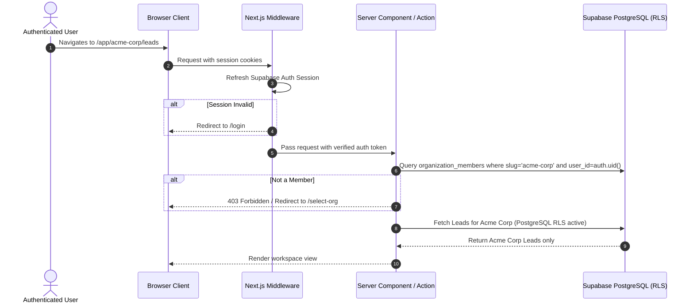

# Multi-Tenancy & Security Architecture

## 1. Principles of Tenant Isolation

In this platform, multi-tenancy is enforced through **defense-in-depth**:
1. **Database Layer (RLS)**: PostgreSQL Row Level Security is active and forced on 100% of tenant tables. Even if application code has a bug or omits a filter, PostgreSQL rejects cross-tenant queries.
2. **Server/API Layer**: Next.js Server Components, Server Actions, and Route Handlers always resolve the user's active organization from authenticated session cookies and membership records.
3. **Zero Client Trust**: A client-supplied `organization_id` or `orgSlug` is never trusted without validating that the authenticated caller (`auth.uid()`) is an active member with appropriate role permissions in that specific organization.

---

## 2. PostgreSQL Row-Level Security (RLS) Implementation

### Helper Security Functions
To avoid slow, repetitive nested queries and optimize PostgreSQL index lookups:

```sql
-- 1. Returns all organization IDs where the authenticated user is an active member
CREATE OR REPLACE FUNCTION auth_user_org_ids()
RETURNS SETOF UUID
LANGUAGE sql
STABLE
SECURITY DEFINER
SET search_path = public
AS $$
  SELECT organization_id
  FROM organization_members
  WHERE user_id = auth.uid()
    AND status = 'active';
$$;

-- 2. Checks if the authenticated user has one of the allowed roles in the given organization
CREATE OR REPLACE FUNCTION auth_has_org_role(target_org_id UUID, allowed_roles TEXT[])
RETURNS BOOLEAN
LANGUAGE sql
STABLE
SECURITY DEFINER
SET search_path = public
AS $$
  SELECT EXISTS (
    SELECT 1
    FROM organization_members
    WHERE organization_id = target_org_id
      AND user_id = auth.uid()
      AND status = 'active'
      AND role = ANY(allowed_roles)
  );
$$;
```

### Standard Table Policies Pattern
Applied uniformly to all tenant-owned tables (`contacts`, `leads`, `conversations`, `messages`, `tasks`, etc.):

```sql
-- Enable and force RLS
ALTER TABLE contacts ENABLE ROW LEVEL SECURITY;
ALTER TABLE contacts FORCE ROW LEVEL SECURITY;

-- SELECT: Permitted if the user belongs to the contact's organization
CREATE POLICY "Tenant isolation select" ON contacts
  FOR SELECT
  TO authenticated
  USING (organization_id IN (SELECT auth_user_org_ids()));

-- INSERT: Permitted only into organizations the user belongs to
CREATE POLICY "Tenant isolation insert" ON contacts
  FOR INSERT
  TO authenticated
  WITH CHECK (organization_id IN (SELECT auth_user_org_ids()));

-- UPDATE: Permitted only within organizations the user belongs to
CREATE POLICY "Tenant isolation update" ON contacts
  FOR UPDATE
  TO authenticated
  USING (organization_id IN (SELECT auth_user_org_ids()))
  WITH CHECK (organization_id IN (SELECT auth_user_org_ids()));

-- DELETE: Permitted only for Owner and Admin roles
CREATE POLICY "Tenant isolation delete" ON contacts
  FOR DELETE
  TO authenticated
  USING (
    organization_id IN (SELECT auth_user_org_ids())
    AND auth_has_org_role(organization_id, ARRAY['owner', 'admin'])
  );
```

---

## 3. Role Hierarchy & Matrix of Permissions

| Capability | Owner | Admin | Staff |
| :--- | :---: | :---: | :---: |
| **View Dashboard & Reports** | ✅ | ✅ | ✅ |
| **Manage Contacts & Leads** | ✅ | ✅ | ✅ |
| **View Shared Inbox & Send Messages** | ✅ | ✅ | ✅ |
| **Manage Assigned Tasks & Follow-ups** | ✅ | ✅ | ✅ |
| **Delete Contacts / Leads** | ✅ | ✅ | ❌ |
| **Manage WhatsApp Connection & Webhooks** | ✅ | ✅ | ❌ |
| **Configure Automation Rules** | ✅ | ✅ | ❌ |
| **Invite & Manage Team Members** | ✅ | ✅ | ❌ |
| **Manage Subscription & Billing** | ✅ | ❌ | ❌ |
| **Delete Entire Organization** | ✅ | ❌ | ❌ |

---

## 4. Multi-Tenant Workspace Resolution Flow



---

## 5. Security Guardrails

1. **Service Role Key Boundary**:
   - `SUPABASE_SERVICE_ROLE_KEY` is strictly prohibited in browser-accessible files and standard route handlers.
   - It is permitted ONLY in:
     - `/api/webhooks/whatsapp` (ingesting incoming messages from Meta before customer identification)
     - `/api/cron/process-jobs` (system job queue dispatcher running with secret verification)
2. **Encrypted Token Storage**:
   - Meta WhatsApp System User Access Tokens are encrypted using AES-256 before storage in `whatsapp_connections.access_token_encrypted`.
   - The encryption key is held only in the environment variable `ENCRYPTION_KEY`.
3. **Cross-Tenant Testing**:
   - Test suites seed two independent organizations (`Org A` and `Org B`) with separate test users.
   - Every API endpoint and table query is verified to ensure User A receives 0 rows or 403 Forbidden when attempting any read/write on Org B data.
